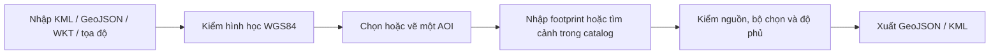
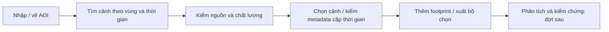

# Dữ liệu GIS và ghi nhận thực địa

Phạm vi: công cụ thử nghiệm trong demo, lưu dữ liệu cục bộ tại trình duyệt. AOI nhập/vẽ ở đây không sửa AOI sự kiện hoặc kết quả tuyến/ưu tiên của DEAR. Luồng có project, quyền, xử lý và công bố được xây tại [Workbench của platform](../../../vsp-eo-platform/docs/architecture/overview.md#workspace).

Mở **GIS** trên thanh công cụ bản đồ, hoặc `/?workspace=geodata`. Công cụ độc lập với DEM và chạy tại trình duyệt, dùng được trên Vercel. Thêm `&offline=1` để không tải nền ngoài.

## Công việc của người ứng phó

GIS mở theo ba công việc: **Vùng sạt lở**, **Đường**, **Dữ liệu**. Vùng sạt lở có hai thao tác khoanh vùng nguy cơ và vết đã sạt, bộ lọc loại vùng/mức rà soát; điểm ghi nhận là tư liệu bổ sung. Đường hiển thị tình trạng từng đoạn, tìm theo tên và mở hồ sơ để cập nhật căn cứ, quan hệ với vùng. Dữ liệu chứa điểm cứu trợ, thôn bản, nhập/xuất file và các tab kỹ thuật Lớp/AOI/Ảnh. Công cụ vẽ AOI chỉ hiện trong AOI/Ảnh; không dùng nút AOI để khoanh sạt lở.

Luồng làm việc: khoanh vùng → ghi nguồn/căn cứ → chọn đoạn đường liên quan (có thể chọn khoảng đầu–cuối trên bản đồ) → đánh giá khả năng đi lại trong hồ sơ đường → xem lại và áp dụng toàn bộ bản nháp. Polygon gần đường hoặc đè lên đường không tự kết luận đường bị chặn. Tab Đường hiện chỉnh tình trạng/thuộc tính/liên kết; chưa phải công cụ biên tập hình học và topology mạng đường.

Áp dụng GIS chỉ cập nhật dữ liệu trên thiết bị. Các tab cùng origin nhận thay đổi tình huống mà không cần tải lại trang; đây không phải đồng bộ giữa các thiết bị. Cảnh báo công khai cần một luồng riêng: người có thẩm quyền duyệt, địa bàn/đường chịu ảnh hưởng, thời gian hiệu lực, thông tin kiểm chứng và hành động người dân cần làm; có cập nhật, hết hiệu lực và thu hồi. Việc lưu polygon hoặc một phản ánh chưa xác minh không tự phát cảnh báo. Kênh gửi thật, xác nhận nhận tin và phân quyền thuộc dịch vụ chia sẻ; demo chưa có các chức năng này. Tham chiếu nguyên tắc [WMO CAP](https://wmo.int/site/wmo-common-alerting-protocol/about-cap), không tuyên bố demo tuân thủ CAP.

## Thao tác

| Tác vụ | Cách dùng |
|---|---|
| Nhập tệp | Tab Lớp: bấm **Nhập dữ liệu** để mở hộp thoại, chọn một/nhiều KML, GeoJSON hoặc WKT. Escape đóng biểu mẫu và trả focus về nút mở. Giữ tên và thuộc tính; bỏ Placemark chỉ chứa ghi chú. KML MultiGeometry được tách thành đối tượng. Lỗi chỉ rõ tệp |
| Nhập văn bản | Trong hộp thoại Nhập dữ liệu, chọn **Dán tọa độ / WKT**. Nhiều WKT có tên như `Strix-2: POLYGON((…))`. Tọa độ DD (`21.782919° N, 104.053554° E`) hoặc DMS (`21°45'26.80"N 104°02'48.44"E`), mỗi dòng một điểm |
| Vai trò | Tham chiếu: nâu. AOI: xanh lá. Phạm vi ảnh: xanh dương nét đứt. Chú giải theo vai trò đang hiện. Điểm có lõi đặc và viền trắng; màu tham chiếu không biểu thị mức tác động |
| Chọn đối tượng | Danh sách ở trái; chọn đối tượng mở hồ sơ ở phải trên màn rộng, thay danh sách trên màn nhỏ. Đóng hồ sơ trở lại danh sách. Giữ vùng nhìn; nút Xem trên bản đồ đưa hình vào map. Đổi tên/vai trò, xem tọa độ và thuộc tính. Điểm có **Sửa tọa độ**; tọa độ mới cập nhật cùng bản ghi, giữ ID, nguồn và độ cao nếu có. Một AOI mỗi workspace, gán AOI mới chuyển AOI cũ thành tham chiếu |
| Điểm thực địa | Bấm **Thêm điểm tọa độ** để mở hộp thoại ngắn, hoặc chọn điểm đã nhập. Có thể xem điểm tham chiếu ngay trên bản đồ ứng phó. Khi thêm ghi nhận, ảnh/giờ/GPS được điền theo metadata có sẵn; loại, ghi chú và người ghi nhận là bổ sung, không bắt nhập sai số vị trí |
| Vùng nghi ảnh hưởng | Trong hồ sơ điểm, chọn **Vẽ vùng nghi ảnh hưởng**. Một điểm có nhiều polygon tham chiếu, màu hổ phách, chưa xác minh; không thay AOI. Có xem vùng, sửa đỉnh, xóa và hoàn tác. Xóa điểm bỏ các vùng liên kết trong cùng một bước; hoàn tác khôi phục cả bộ |
| Vẽ AOI | Thanh công cụ: polygon hoặc hình chữ nhật qua hai góc đối diện. Polygon kết thúc bằng Enter, nút Kết thúc, nhấp đúp hoặc đỉnh đầu. Vẽ lại cập nhật AOI hiện tại. Thanh công cụ không làm map dịch chuyển |
| Chỉnh hình | Kéo đỉnh hoặc nhập kinh/vĩ độ tại tab AOI. Áp dụng mới cập nhật bản lưu; hình lỗi giữ nguyên bản cũ. Hủy/Esc bỏ bản nháp. Bắt đỉnh trong 12 pixel tới các đối tượng đang hiện |
| Hoàn tác | Ctrl/Cmd+Z, Ctrl/Cmd+Shift+Z hoặc các nút Hoàn tác/Làm lại. Trong lúc chỉnh chỉ tác động bản nháp; ngoài lúc chỉnh tác động lớp. Lịch sử 25 bước, trong phiên |
| Bật/tắt | Chỉ đổi hiển thị, không bỏ footprint khỏi phép tính |
| Nguồn | Định dạng, đầu vào, thời điểm nhập, thuộc tính, WKT và tham chiếu Z nếu có. Vĩ độ/kinh độ ghi riêng. Thời điểm nhập không phải ngày chụp hoặc khảo sát |
| Xuất | GeoJSON/KML cho cả bộ hoặc riêng AOI, copy WKT đối tượng chọn. KML giữ mô tả, thuộc tính dạng văn bản và altitudeMode. GeoJSON kèm vai trò, nguồn và phương pháp tính |

## Quan hệ với bản đồ ứng phó

| Phần | Cách liên kết |
|---|---|
| Đối tượng GIS | Một phiên dữ liệu dùng chung trong ứng dụng, giữ ID, hình học, thuộc tính và lựa chọn khi đóng/mở GIS. Tab Lớp quản lý dữ liệu; bảng Lớp bản đồ bật/tắt lớp GIS đã nhập |
| Vị trí | Hiện các hình WGS84 trên bản đồ ứng phó 2D. Vùng sạt lở có thêm hình bám DEM trong 3D, giữ khoảng trống NoData; dữ liệu GIS khác vẫn dùng 2D |
| Ghi nhận | Điểm có loại nghi sạt lở, hư hỏng đường, nước/ngập hoặc khảo sát. Ký hiệu cảnh báo và nhãn Chưa xác minh cho ghi nhận mới; chọn điểm mở ghi chú và ảnh |
| Đánh giá tình huống | Ghi nhận mới không tự sửa vùng thiên tai, mức ưu tiên, trạng thái tuyến hoặc nhật ký phân tích. AOI làm việc không thay AOI sự kiện |
| Lưu/chia sẻ | GeoJSON/KML giữ ID nguồn để khi nhập lại tạo ID mới và nối vùng với đúng điểm trong bộ nhập, không nối nhầm với bản cũ. Vùng nhập thiếu điểm vẫn là tham chiếu chưa liên kết. Bản mở độc lập cùng origin đọc cùng bộ lưu. GeoJSON/KML giữ dữ liệu ghi nhận và bản xem trước ảnh. Không gửi báo cáo hoặc đồng bộ người dùng |

## Chỉnh dữ liệu tình huống

Khi mở từ DEAR với vai trò điều phối viên, GIS hiển thị cùng các thôn/bản, tuyến và sự cố của bản đồ ứng phó. Hai màn dùng chung bộ ký hiệu và cách gom các đối tượng chồng nhau; bấm nhóm để chọn từng đối tượng. Hover giữ nguyên vị trí. Bấm **Di chuyển trên bản đồ**, kéo điểm rồi ghi lý do/lưu vị trí; thay đổi đi qua nhật ký dùng chung. Tên thôn/bản và đường có thể đổi trong hồ sơ GIS bằng cùng thao tác đổi tên của màn ứng phó. Thay đổi hiện lại trên bản đồ chính và được lưu trong trình duyệt.

Điểm tham chiếu nhập từ KML/GeoJSON vẫn thuộc bộ dữ liệu GIS. Sửa tên/tọa độ hoặc khoanh vùng không tự xác nhận một sự cố hay cập nhật trạng thái đường. Nguồn ảnh, tọa độ GPS gốc và vị trí hiển thị được giữ riêng để đối chiếu. Workspace độc lập không có gói tình huống vẫn chỉ quản lý dữ liệu nhập.

Backend dùng chung với EO là bước tiếp theo: [thiết kế lát cắt đầu tiên](../../../vsp-eo-platform/docs/plans/backend-first-slice.md). Hiện hai repo chưa đồng bộ qua server; liên kết GIS/ứng phó nêu trên là trong cùng DEAR và cùng trình duyệt.

## Vùng nguy cơ và vết sạt lở

Trong tab Lớp, dùng **Khoanh vùng nguy cơ** hoặc **Khoanh vết sạt lở**. Vẽ polygon trên bản đồ, lưu căn cứ và áp dụng cùng bản nháp GIS. Vùng tồn tại độc lập với điểm chụp ảnh và AOI; có thể gắn các ghi nhận làm nguồn. Polygon tham chiếu đã nhập cũng có thể được phân loại thành vùng sạt lở. Nguồn thực địa, ảnh vệ tinh/ảnh bay, phản ánh người dân, hồ sơ cũ và địa hình/địa chất được lưu riêng; tiếng động bất thường hoặc vết nứt là dấu hiệu cần kiểm tra, không tự trở thành kết luận đã sạt.

Phân biệt **vùng có nguy cơ** và **dấu vết đã xảy ra**; khi đủ căn cứ có thể ghi vùng phát sinh, lan truyền xuống dốc hoặc bồi tích. Hồ sơ lưu thời điểm tư liệu nếu biết, mã ảnh và độ phân giải, sai số ranh giới nếu đã đánh giá, người/mức rà soát. Không suy sai số ranh giới từ kích thước pixel. “Đã rà soát tư liệu” khác “Đã kiểm tra thực địa”. Vùng chưa đủ nguồn/căn cứ giữ trong bản nháp và chưa áp dụng được.

Liên kết vùng với một hay nhiều đoạn đường theo nhận định của cán bộ, kể cả vùng sườn dốc không giao trực tiếp với mặt đường. Có thể chọn hai đầu trên bản đồ hoặc nhập khoảng mét từ đầu đoạn đường để xác định phần liên quan. Quan hệ **có thể ảnh hưởng / đã có ảnh hưởng** được lưu riêng với tình trạng đi lại. Muốn ghi đường bị chặn, mở hồ sơ đoạn đường, ghi lý do và xác nhận tình trạng; thay đổi vùng và đường được áp dụng cùng một lần. Đánh giá tình trạng hiện áp dụng cho đoạn đường trong mạng, chưa chia mạng thành các cạnh mới từ khoảng ảnh hưởng. Di chuyển hoặc sửa vùng không tự mở lại đường. Liên kết đường mang phiên bản bộ dữ liệu, cần chọn lại nếu đổi mạng đường.

GeoJSON/KML giữ metadata `dearLandslideArea`, hình học, nguồn, trạng thái rà soát và liên kết. Khi nhập lại, nguồn điểm chỉ nối với điểm nằm trong cùng bộ nhập; nguồn ngoài bộ vẫn được đánh dấu chưa có hồ sơ. Vùng nhập từ mạng đường khác không tự gắn vào đường trùng mã. Các quy tắc này tham khảo [USGS inventory và susceptibility](https://www.usgs.gov/tools/us-landslide-inventory-and-susceptibility-map?items_per_page=6), [dấu hiệu chuyển động sườn dốc](https://www.usgs.gov/programs/landslide-hazards/science/landslide-basics) và [phân biệt nguồn, lan truyền và bồi tích](https://pubs.usgs.gov/ds/1064/ds1064.pdf). Công cụ khoanh vùng hỗ trợ diễn giải và ghi nhận; chưa có mô hình ổn định sườn dốc hoặc mô phỏng runout.

Ảnh GeoTIFF Planet và điều chỉnh band/range/gamma, nhập nhiều raster và xuất ảnh hiển thị thuộc Workbench EO; nguồn gốc, giới hạn raster và timeline được giữ tại [quy trình ảnh EO](../../../vsp-eo-platform/docs/plans/imagery-timeline-and-planet.md). DEAR không dùng ảnh nền cũ để xác nhận vết sạt mới.

## Hồ sơ điểm và ảnh

Chọn điểm trên bản đồ hoặc danh sách để mở hồ sơ. Nhập tệp nhiều điểm giữ danh sách làm màn tổng quan; không mở hàng trăm khối thuộc tính. Trên desktop, hồ sơ đặt bên phải và cuộn riêng; trên màn hẹp, đóng hồ sơ để trở lại danh sách. Chọn **Xem trên bản đồ** khi cần định vị; lựa chọn đơn thuần giữ vùng nhìn.

Ảnh vừa thêm hiện bản xem trước, giờ chụp, máy ảnh và GPS đọc được. Chọn ảnh để mở lớn; Escape đóng ảnh, giữ nguyên màn GIS. Thông số máy ảnh khác và checksum nằm trong phần mở rộng. Thời gian EXIF hoặc TimeStamp KML/thuộc tính thời gian hợp lệ được điền khi trường còn trống, không ghi đè thao tác nhập tay. Giờ máy ảnh thiếu offset được lưu là `observedLocalTime` với múi giờ chưa xác định, không tự gán UTC; giờ có offset được lưu là `observedAt`. Không dùng ngày sửa tệp hay ngày nhập làm thời điểm hiện trường.

**Vẽ vùng nghi ảnh hưởng** là khoanh vùng thủ công trên bản đồ dựa vào căn cứ đang xem, không suy polygon từ ảnh chụp mặt đất. Dữ liệu `dearFieldArea` gắn polygon tham chiếu với ID điểm, giữ trạng thái chưa xác minh. Bản nháp ảnh và ghi chú không mất khi chuyển sang vẽ vùng. AOI tìm ảnh, vùng khoanh vẽ và vùng thiên tai của tình huống là các đối tượng có mục đích riêng.

Hướng dẫn sử dụng nằm ở nút **?** trên header ứng phó; chủ đề **Điểm và ảnh thực địa** mô tả luồng này.

## Ảnh hiện trường và hướng mở rộng

Mỗi điểm tối đa ba ảnh JPEG/PNG/WebP, mỗi ảnh tối đa 8 MB và 40 megapixel. Demo lưu bản JPEG xem trước cạnh dài tối đa 1.280 pixel, thông số EXIF đọc được và SHA-256 của **tệp gốc**. Toàn phiên vẫn chịu giới hạn lưu 4 MB; lưu lỗi giữ nguyên hồ sơ cũ. Tệp gốc không được lưu trong demo, cần giữ riêng để phân tích.

GPS EXIF là vị trí máy ảnh, có thể khác vị trí hiện tượng. Không tự đổi tọa độ điểm theo ảnh. Thời gian nhập, thời gian người khảo sát khai báo và giờ EXIF là các mốc riêng; giờ EXIF có thể thiếu múi giờ. Thiếu EXIF không đồng nghĩa ảnh không hợp lệ. Demo chưa phân loại sạt lở từ ảnh hoặc kiểm chứng độ tin cậy EXIF.

Luồng ứng dụng người dân nên có ba bước: tiếp nhận ghi nhận và ảnh gốc, người có trách nhiệm xác minh, công bố lớp phục vụ ứng phó. Hợp đồng dữ liệu cần ID ổn định, vị trí hiện tượng và vị trí chụp riêng, độ chính xác và nguồn tọa độ, thời điểm kèm múi giờ, người gửi, tệp gốc và checksum, kết quả xác minh. Platform quản lý tệp, quyền và đồng bộ; DEAR đọc dữ liệu đã công bố. Đây là hướng mở rộng, chưa phải chức năng backend của demo.

Tham khảo mô hình đối tượng có vị trí, biểu mẫu và ảnh của [ArcGIS Field Maps](https://doc.arcgis.com/en/field-maps/ios/use-maps/capture.htm) và thông số ảnh của [Survey123](https://doc.arcgis.com/en/survey123/create/main/xlsformmedia.htm).

## Quy tắc khoa học

| Nội dung | Quy tắc |
|---|---|
| CRS đầu vào/lưu/xuất | WGS84 theo **kinh độ, vĩ độ**, tương ứng OGC:CRS84 trong GeoJSON. WKT nhận `SRID=4326`. Chưa chuyển VN2000/UTM |
| CRS hiển thị | Web Mercator EPSG:3857. Không tính diện tích theo pixel hoặc diện tích phẳng Web Mercator |
| Hình học | Kiểm khép vòng, đỉnh, tự cắt, cạnh chồng, lỗ ngoài biên/chạm biên/chồng nhau, MultiPolygon chồng diện tích |
| Độ phủ | Diện tích giao của AOI với **hợp** các footprint / diện tích AOI. Không đếm trùng vùng chồng. Chưa có footprint: chưa xác định, không ghi 0% |
| Phương pháp | Giao/hợp polygon trong kinh/vĩ độ. Diện tích xấp xỉ mặt cầu R = 6.371.008,8 m, m²/km², `polygon-coverage-v1`. Không phải diện tích ellipsoid phục vụ địa chính hoặc diện tích bề mặt địa hình |
| Z | Giữ giá trị và KML altitudeMode riêng từng hình học, kể cả mode sea-floor; thiếu mode dùng clampToGround. KML thiếu Z trong hình có Z nhận 0. Z không tham gia độ phủ/vị trí 2D. WKT/GeoJSON chưa rõ tham chiếu Z: ghi chưa xác định, xuất KML bám đất, không suy cao độ tuyệt đối hoặc DEM |
| Footprint | Chỉ là biên hình học. Chưa xác nhận ảnh đã chụp, yêu cầu đặt chụp thành công, không mây hoặc đủ chất lượng phân tích |
| Nền ảnh | EOX Sentinel-2 cloudless 2016, giữ attribution/giấy phép. Không dùng làm bằng chứng hiện trạng |

[OGC KML](https://docs.ogc.org/is/12-007r2/12-007r2.html) quy định thứ tự tọa độ KML là kinh độ, vĩ độ, độ cao. Luồng AOI tham khảo [Copernicus Browser](https://documentation.dataspace.copernicus.eu/Applications/Browser.html). Tính hợp/giao dùng [Turf union](https://turfjs.org/docs/api/union), [intersect](https://turfjs.org/docs/7.1.0/api/intersect); diện tích dùng [Turf area](https://turfjs.org/docs/api/area).

## Giới hạn

| Phần | Giới hạn |
|---|---|
| Dung lượng | 5 MB/tệp UTF-8, 10 tệp/lần, 20 MB/lần, 1.000 đối tượng và 50.000 tọa độ/phiên; tối đa 1.500 tọa độ/đối tượng. Bản lưu phiên tối đa 4 MB. Giản lược hoặc tách dữ liệu trong QGIS |
| Lỗi nhập | Một tệp trong lô bị lỗi: không thêm một phần lô, giữ nguyên bộ đang có |
| Chưa hỗ trợ | KMZ, NetworkLink, lớp ảnh KML, Track/Model, vùng vượt kinh tuyến 180°, vĩ độ ngoài ±85,05112878° |
| Trình bày KML | Dùng ký hiệu theo vai trò làm việc; không giữ Style/StyleMap, cây Folder, extrude/tessellate hoặc cảnh 3D gốc. Không phải trình xem KML đầy đủ như Google Earth |
| Điểm trùng/gần nhau | Giữ nguyên tọa độ, không tự nối đường hoặc dịch điểm. Chọn từng đối tượng qua danh sách khi map bị chồng; chưa có bộ chọn cụm hoặc tìm theo thuộc tính |
| Lưu/chia sẻ | LocalStorage theo origin, kiểm dữ liệu khi mở lại. Xuất tệp để giữ/chia sẻ. Chưa có tài khoản, đồng bộ, checksum tệp gốc hoặc lịch sử nhập |
| Nhập lại bản xuất | Lựa chọn Theo tệp giữ `geometryRole` từ GeoJSON/KML của công cụ; tệp không có vai trò dùng Tham chiếu. Chọn vai trò khác để ghi đè khi nhập |

## Catalog prepared

**Bước catalog prepared đã tích hợp.** Tab Cảnh ảnh dùng 12 bản ghi STAC thật: sáu Sentinel-1 GRD và sáu Sentinel-2 L2A, thu nhận 24/09–07/10/2026 quanh Chế Tạo. Snapshot metadata lấy từ Copernicus Data Space ngày 08/10/2026; `public/catalog/che-tao.json` giữ truy vấn gốc, nguồn và giấy phép. App đọc tệp cùng origin, chạy trên Vercel và trong gói offline, chưa truy vấn catalog trực tiếp. [Maquette](assets/analysis-workspace.html) là bản nghiên cứu bố cục trước triển khai.

| Thành phần | Cách dùng hiện tại |
|---|---|
| Khung làm việc | Header và thanh công cụ cố định; panel đổi rộng, ba tab **Lớp / AOI / Cảnh ảnh** có vị trí cuộn riêng. Tên AOI ở thanh công cụ |
| AOI | Một AOI cho lần tìm; sửa hình đánh dấu kết quả cũ và yêu cầu tìm lại. Bộ chọn giữ nguyên, không tự thay đầu vào |
| Tìm ảnh | Collection, ngày UTC, giao polygon AOI; mây chỉ áp dụng Sentinel-2 và là mây toàn cảnh. Thêm kết quả theo nhóm sáu. Có trạng thái tải/lỗi/rỗng và thử lại |
| Kết quả | Sensor, thời gian UTC, độ phủ hình học AOI và polarization hoặc mây. Icon thay thumbnail; chưa tải ảnh preview hoặc band |
| Chọn và xem | Bấm dòng/footprint xem metadata, checkbox đưa vào bộ chọn. Hiện/ẩn footprint và zoom không đổi bộ chọn. Nút Xem phạm vi đổi vùng nhìn khi được yêu cầu |
| Metadata | ID, nguồn STAC, processing level; SAR có pass/relative orbit/polarization/pixel spacing, quang học có GSD sản phẩm/mây. Thiếu trường ghi “—”. Pixel spacing không phải spatial resolution |
| Cặp thời gian | Hai cảnh cùng collection/mức xử lý, khác thời điểm và có vùng giao trong AOI; SAR kiểm thêm orbit/pass/mode/polarization. Chỉ kiểm metadata, chưa kiểm mask/raster/đồng đăng ký |
| Đầu ra | Bộ chọn theo thời gian lưu cục bộ; xuất JSON kèm AOI/nguồn/trạng thái kiểm và `rasterLoaded: false`. Thêm footprint vào lớp không tạo bản sao trùng ID |
| Lớp và pointer | Từ dưới lên: nền → footprint → tham chiếu → AOI → phần giao → đối tượng chọn → điểm → bản nháp. Chỉ một chế độ nhận thao tác chỉnh; chưa có raster catalog |
| Màn nhỏ | Chuyển **Dữ liệu / Bản đồ**. Inspector thay vùng map/data; Xem phạm vi đóng inspector và mở map. Không chồng ba panel nổi |

Catalog này có phạm vi/ngày hữu hạn; không có kết quả không có nghĩa là kho ảnh vệ tinh không có ảnh. Độ phủ footprint không thay độ phủ pixel hợp lệ hay tỷ lệ không mây trong AOI. GSD sản phẩm chưa mô tả độ phân giải từng band Sentinel-2. Contract sản phẩm, nguồn trực tiếp, asset raster/QA, worker và công bố thuộc [lộ trình platform](../../../vsp-eo-platform/docs/plans/roadmap.md), không mở rộng thành backend trong repo demo.

### Tham chiếu và lựa chọn

Đây là lựa chọn thiết kế cho DEAR từ tài liệu chính thức và ảnh người dùng cung cấp, không phải một tiêu chuẩn bắt buộc chung cho WebGIS.

| Công cụ | Áp dụng vào DEAR |
|---|---|
| [SkyFi](https://skyfi.com/en/faqs), [tasking](https://learn.skyfi.com/how-to/tasking-a-satellite-to-capture-a-new-image/) | AOI và danh sách ảnh; tách archive khỏi yêu cầu chụp. Không đưa luồng mua/assistant vào bước đầu |
| [Copernicus Browser](https://documentation.dataspace.copernicus.eu/Applications/Browser.html) | Tìm theo collection/thời gian, footprint, metadata, bộ chọn và so ảnh. Tách tìm sản phẩm khỏi hiển thị ảnh |
| [QGIS GUI](https://docs.qgis.org/3.44/en/docs/user_manual/introduction/qgis_gui.html) | Dock ổn định, thứ tự lớp, thuộc tính, identify và chế độ thao tác rõ. Không sao chép toàn bộ toolbar desktop |
| [Earth Engine](https://developers.google.com/earth-engine/guides/playground) | Inspector khi cần và Tasks cho xử lý dài. Không dùng RGB nền làm giá trị band hay thêm console sớm |
| [EOSDA LandViewer](https://eos.com/user-guide/landviewer/my_landviewer/) | Tổ hợp band, chỉ số, so ảnh và chuỗi thời gian cho đợt có raster/QA |
| [UNOSAT](https://unosat.org/products/4256) và ảnh giao diện đã gửi | Màn ứng phó tập trung tác động, phạm vi, nguồn và thời điểm; công cụ phân tích nằm ở workspace riêng. Chưa kiểm trực tiếp toàn bộ thao tác của webmap |

Proposal vẫn là đích nghiệp vụ: SAR ưu tiên sau sự kiện, phân tích tác động đường/cộng đồng rồi tạo sản phẩm cứu hộ. Catalog là đầu vào hỗ trợ luồng đó, không thay pipeline hoặc biến demo thành sản phẩm xử lý tự động.

Hoàn tác sau khi áp dụng tạo một bản nháp mới, không thay ngược dữ liệu đang dùng. Dữ liệu nhận từ tab khác làm mới lịch sử Hoàn tác để không xóa nhầm ghi nhận vừa nhận. So sánh xung đột dựa trên nội dung JSON, không phụ thuộc thứ tự trường. Khi sửa ranh giới vùng sạt lở, mức rà soát trở về chưa rà soát; căn cứ và liên kết đường vẫn được giữ.
